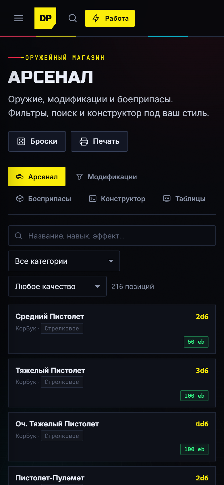
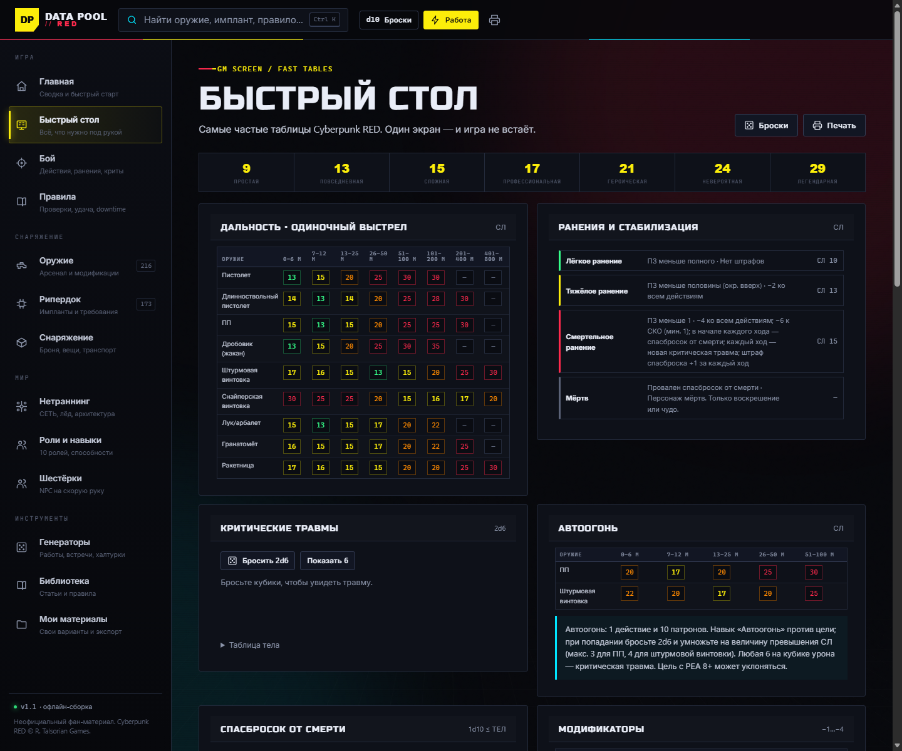
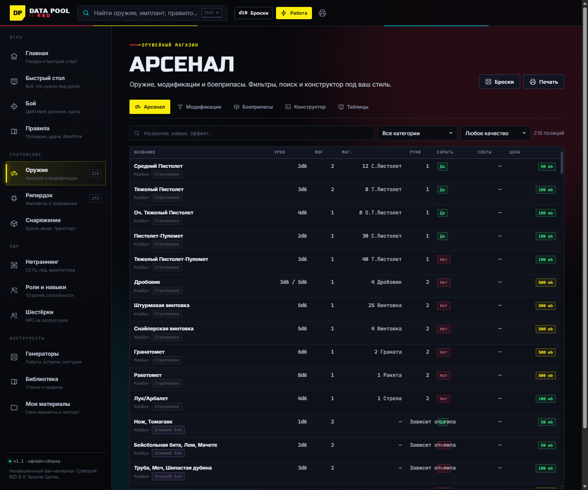
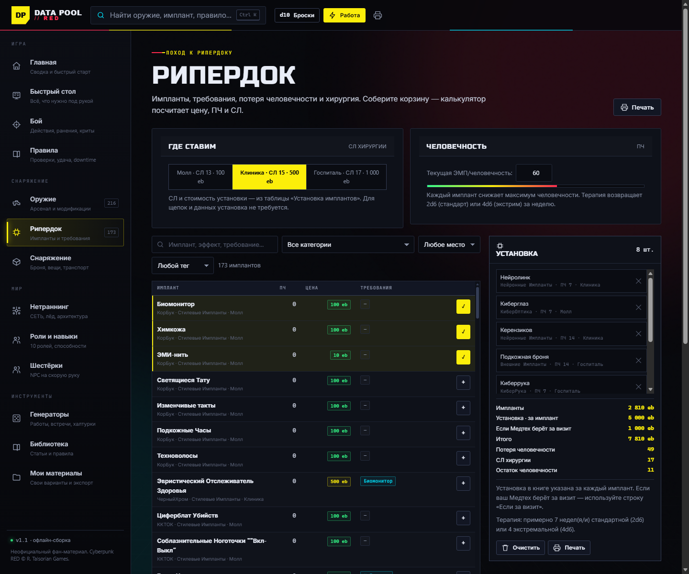
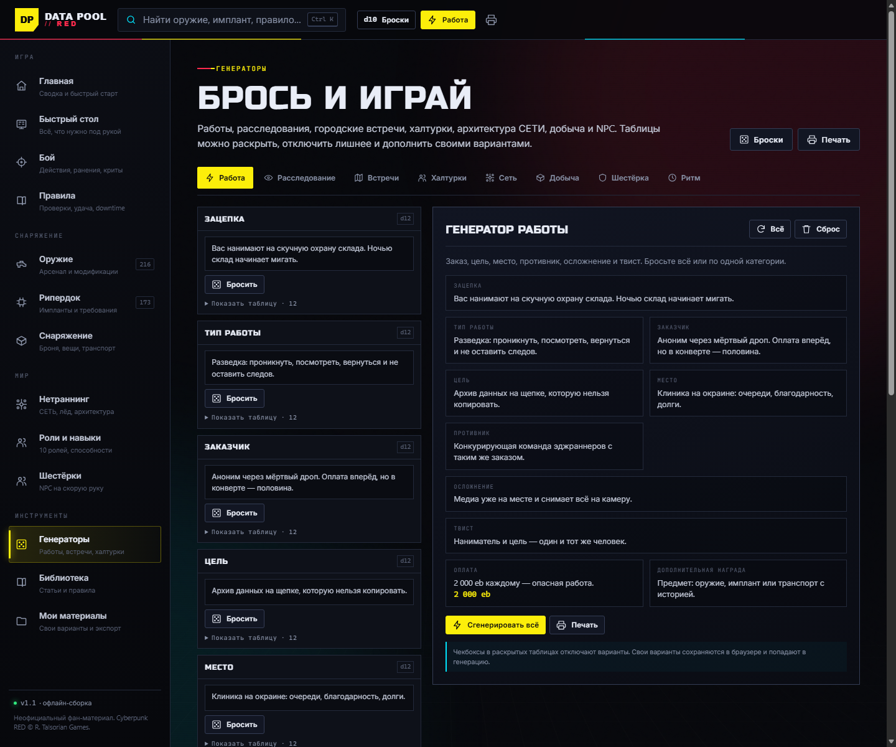
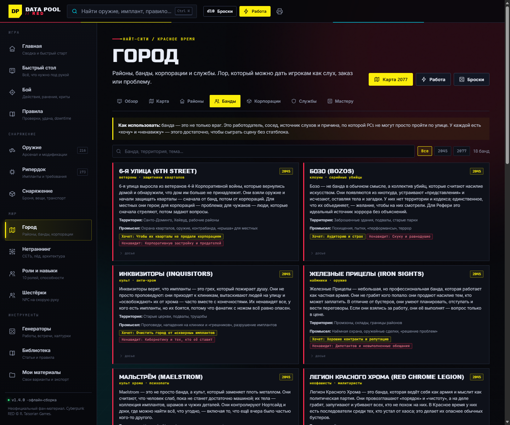
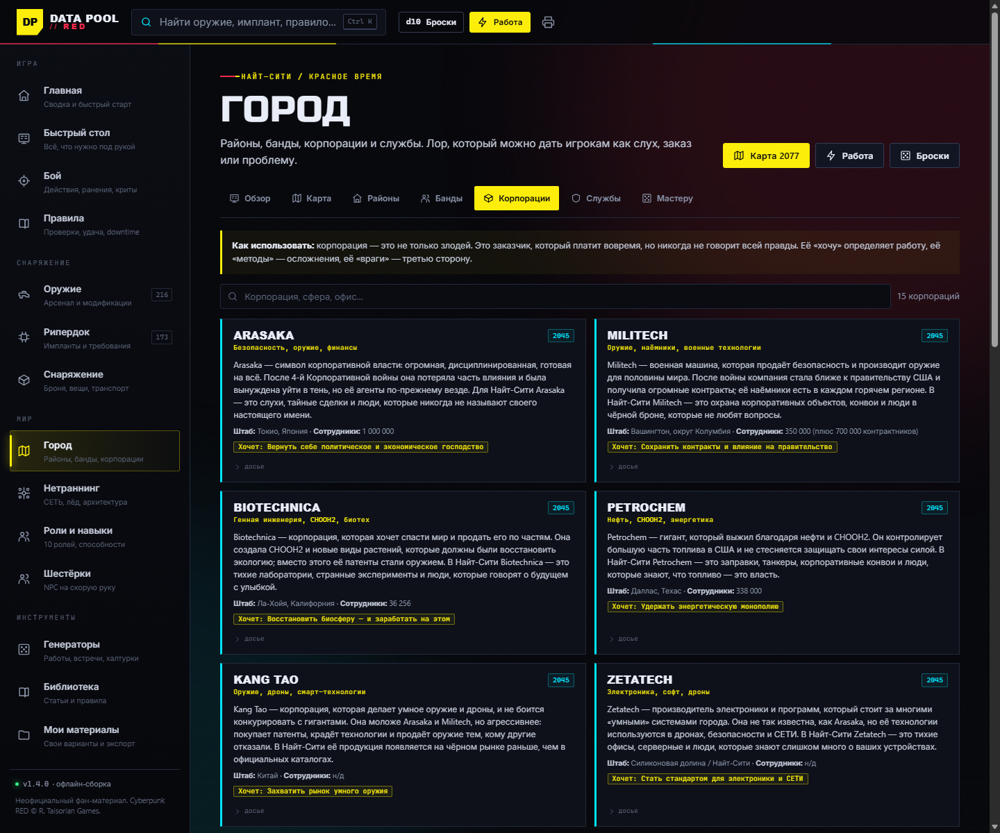
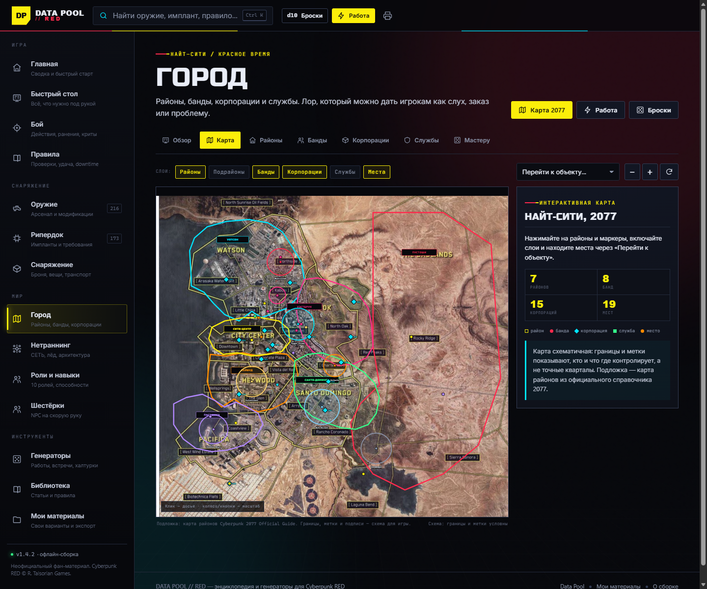
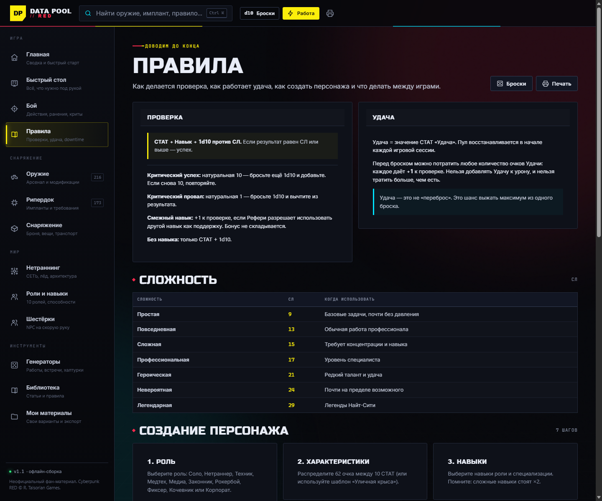

# DATA POOL // RED

Русскоязычная энциклопедия и набор генераторов для **Cyberpunk RED**. Сделана как быстрый инструмент для игры: таблицы, фильтры, конструктор оружия, калькулятор рипердока и генераторы, которые не тормозят сессию.


## Быстрый запуск

**Windows:** дважды щёлкните `start.cmd` — он откроет `index.html` в браузере. Сайт полностью статический и работает по `file://`; `localStorage` (свои варианты, корзина) в современных браузерах сохраняется и так.

Если браузер капризничает с `file://`, поднимите локальный сервер:

Через терминал:

```bash
cd cyberpunk-red
python -m http.server 8777 --bind 127.0.0.1
# открыть http://127.0.0.1:8777/
```

Сборка не требуется: это статические HTML/CSS/JS. Все данные лежат в `data/*.js`, шрифты — локально в `assets/fonts/`. На телефоне интерфейс перестраивается в карточки.



## Что внутри

### Быстрый стол
СЛ, дальность одиночного выстрела, автоогонь, ранения, спасбросок от смерти, действия, модификаторы, броня и лечение — на одном экране. Критические травмы бросаются кнопкой (тело/голова/суперкритический удар).



### Арсенал и модификации
- 216 единиц оружия: пистолеты, ПП, тактическое, тяжёлое, луки, ближний бой, экзотика, 2070-е.
- 22 модификации с фильтрами по слотам, совместимости и цене.
- Боеприпасы, магазины и таблицы дальности.
- **Конструктор:** выбираете ствол, добавляете модификации, видите занятые слоты, итоговую цену и предупреждения.



### Рипердок
- 173 импланта: категория, место установки, ПЧ, цена, требования (родительский имплант, ТЕЛ, слоты).
- Корзина установки: сумма имплантов, стоимость установки, максимальная СЛ хирургии, остаток человечности, предупреждения о нехватке родительских имплантов и киберпсихозе.
- Переключение места установки: Молл / Клиника / Госпиталь.
- Терапия и таблица требований.



### Генераторы
- **Работа:** зацепка, тип, заказчик, цель, место, противник, осложнение, твист, оплата, награда.
- **Расследование:** преступление, место, жертва, подозреваемые, улики, мотив, твист, виновный.
- **Встречи в городе:** день/вечер/ночь, зоны (умеренная, корпоративная, административная, боевая), d100.
- **Халтурки:** все 10 ролей, d6, оплата по рангам 1–4 / 5–7 / 8–10.
- **Архитектура СЕТИ:** этажи, лёд, данные, контроль, ловушки, награды.
- **Добыча** и **шестёрка** на скорую руку.
- **Диаграмма ритма:** крючок → развитие → клиффхэнгер → кульминация → эпилог.

Каждая таблица раскрывается: видно все книжные варианты, можно отключить лишние чекбоксом и добавить свои. Свои варианты сохраняются в браузере.



### Город
- **7 районов** Найт-Сити: Уотсон, Уэстбрук, Сити-Центр, Хейвуд, Санто-Доминго, Пасифика и Пустоши. У каждого — атмосфера, контроль, опасность, места и зацепки.
- **18 банд** с метками 2045/2077: 6-я улица, Бозо, Инквизиторы, Железные Прицелы, Maelstrom, Легион Красного Хрома, Пираны, Игроки Прайм-Тайма, Отступники, Стальные Вакуэро, Тигриные Когти, Вудуисты, Valentinos, Animals, Moxes и скавверы.
- **15 корпораций**: Arasaka, Militech, Biotechnica, Petrochem, Kang Tao, Zetatech, Raven, Trauma Team, Network 54, Continental Brands, Danger Gal, Rocklin, Ziggurat, Zhigafa, SovOil — с «хочет / методы / враги / типичные работы».
- **10 служб**: NCPD, Trauma Team, MaxTac, пожарные, транспорт, Data Pool, рипердоки, фиксеры, кочевники, корпоративная охрана.
- **Мастеру:** Heat фракций, отношения, d20 слухов (с «правдой»), d20 событий, d20 зацепок и лица города.
- **Карта 2077:** интерактивные слои, зум и кликабельные районы/маркеры.






### Карта Найт-Сити 2077
- **Интерактивная схема города:** 7 районов, 22 подрайона, 8 основных банд 2077, 15 корпораций, 5 служб и 19 примечательных мест.
- **Слои:** районы, подрайоны, банды, корпорации, службы и места — включаются отдельно.
- **Управление:** зум и панорама, «Перейти к объекту», клик по району/маркеру открывает досье в боковой панели.
- **Метки:** территории банд, корпоративные анклавы, NCPD/MaxTac, Trauma Team, клубы, клиники, бары и другие места.
- Карта схематичная; подложка — карта районов из официального справочника 2077.



### Библиотека
50 статей по снаряжению, здоровью, городу, мастерской, хрому, жилью, контактам, СЕТИ, работам и экономике. Таблицы внутри статей адаптированы под тёмную тему и печать.

### Правила
Проверки, крит, удача, сложности, создание персонажа, прокачка, репутация и downtime — коротко и с таблицами.



### Мои материалы
Экспорт/импорт JSON, список своих вариантов, корзина и недавние материалы. Всё хранится локально, ничего не уходит на сервер.

## Как пользоваться на игре

- `Ctrl+K` (или `/`) — глобальный поиск по оружию, имплантам, правилам и статьям.
- Нажмите на строку оружия или импланта — откроется подробное описание.
- В «Быстром столе» кнопки критических травм бросают 2d6 и показывают эффект.
- В «Генераторах» кнопка «Всё» перебрасывает все категории, «Печать» — выводит результат.
- Чекбоксы в раскрытых таблицах отключают варианты, которые не подходят тону игры.
- Свои варианты добавляются внизу таблицы и попадают в генерацию.
- На карте города включайте слои, используйте «Перейти к объекту», зум и панораму; клик по району или маркеру открывает досье.

## Структура

```
cyberpunk-red/
  index.html
  start.cmd
  assets/
    img/nc2077-map.jpg     — подложка карты 2077
    css/app.css, fonts.css
    js/app.js              — роутер, общие компоненты, главная, быстрый стол, бой, правила
    js/pages-arsenal.js    — арсенал, модификации, рипердок
    js/pages-equipment.js  — снаряжение, СЕТЬ, библиотека, «Мои материалы»
    js/pages-generators.js — все генераторы
    js/pages-city.js       — город: районы, банды, корпорации, службы, стол мастера
    js/pages-map.js        — интерактивная карта Найт-Сити
    fonts/                 — локальные woff2
  data/
    core.js                — СЛ, ранения, криты, действия, броня, лечение
    lore.js                — районы, банды, корпорации, службы, слухи, события
    map.js                 — геометрия и метки интерактивной карты
    roles.js               — 10 ролей, 60 навыков, 10 NPC
    adventure.js           — таблицы работ, расследований, СЕТИ, добычи, NPC, ритма
    arsenal.js             — оружие, модификации, боеприпасы
    cyberware.js           — импланты
    equipment.js           — броня, вещи, наркотики, транспорт, услуги, жильё
    generators.js          — встречи и халтурки
    library.js             — статьи библиотеки
  preview/                 — скриншоты
```

## Источники и благодарности

- **Cyberpunk RED** © R. Talsorian Games. Правила, названия и часть текстов принадлежат правообладателям.
- Русскоязычная база **Data Pool** — <https://alec-leon.github.io/data-pool/>. Оттуда взяты значительная часть описаний, таблиц снаряжения, имплантов и статей; структура и подача переработаны.
- Главы «Встречи в Красное время», «Диаграмма ритма», таблицы халтурок и критические травмы адаптированы из корбука.
- Шрифты: Russo One, Inter, JetBrains Mono (SIL Open Font License).

Это неофициальный фан-материал для личного использования. Не для продажи.

## Ограничения

- Часть описаний имплантов и оружия сохраняет исходную редактуру источника; если найдёте ошибку — исправьте в `data/*.js` или добавьте свой вариант в генератор.
- Автоматическая проверка совместимости модификаций оружия — эвристическая. Финальное слово за Рефери.
- Стоимость установки в корзине считается за каждый имплант; если ваш Медтех берёт за визит, используйте строку «Если за визит».
- `localStorage` привязан к браузеру и адресу. Для переноса используйте экспорт/импорт в «Моих материалах».
- Интерактивная карта — схема, а не точная картография. Подложка взята из официального справочника 2077 и используется как фан-материал; границы и метки могут не совпадать с каноном на 100%.
